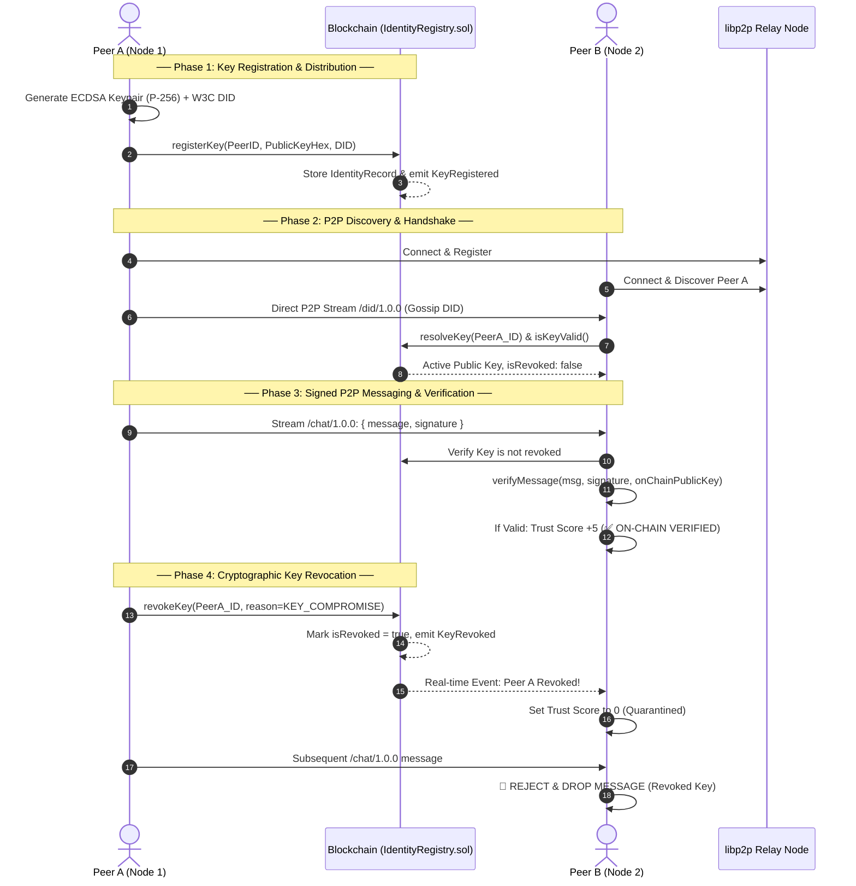

# Decentralized P2P Network with Blockchain DPKI (Key Management, Distribution & Revocation)

A decentralized Peer-to-Peer (P2P) communication framework combining **libp2p** and an **EVM-based Decentralized Public Key Infrastructure (DPKI)** smart contract (`IdentityRegistry.sol`).

---

## 🏛️ System Architecture



---

## 🚀 Quick Start Guide

### 1. Prerequisites
- **Node.js**: v18+ or v22+
- **npm**: v9+

### 2. Installation
Navigate to `p2p-simple`:
```bash
cd p2p-simple
npm install
```

### 3. Step 1: Start Local Blockchain Node
In Terminal 1:
```bash
npm run chain
```
*This starts a local Hardhat EVM node at `http://127.0.0.1:8545`.*

### 4. Step 2: Compile & Deploy Smart Contract
In Terminal 2:
```bash
npm run compile
npm run deploy
```
*This compiles `contracts/IdentityRegistry.sol` and deploys it to the local chain, saving the contract address to `contracts/deployedRegistry.json`.*

### 5. Step 3: Run Automated Test Suite
To verify the full DPKI pipeline (Registration $\rightarrow$ Resolution $\rightarrow$ Signature Verification $\rightarrow$ Forged Signature Detection $\rightarrow$ Revocation $\rightarrow$ Rotation):
```bash
npm run test-dpki
```

---

## 💬 Running Multi-Node Interactive P2P Network

### Terminal 1: Start the Relay / Bootstrap Node
```bash
npm run relay
```
*Copy the displayed Relay multiaddress (e.g. `/ip4/127.0.0.1/tcp/4001/p2p/12D3KooW...`).*

### Terminal 2: Start Peer 1
```powershell
node peer.js 0
# Or: $env:WALLET_INDEX=0; npm run peer
```

### Terminal 3: Start Peer 2
```powershell
node peer.js 1
# Or: $env:WALLET_INDEX=1; npm run peer
```

### Terminal 4 (Optional): Start Adversarial Peer (Bad Peer)
```powershell
node bad-peer.js 2
# Or: $env:WALLET_INDEX=2; npm run bad-peer
```

---

## ⌨️ Interactive CLI Commands in `peer.js`

| Command | Description |
| :--- | :--- |
| `<message text>` | Signs with ECDSA private key and broadcasts message to all connected peers. |
| `register` | Registers the node's Peer ID and public key on the blockchain. |
| `lookup <peerId>` | Queries the on-chain identity record, owner, public key, and revocation status for any peer ID. |
| `revoke [reason]` | Cryptographically revokes current key on-chain (`1`: Compromised, `2`: Superseded, `3`: Decommissioned). |
| `rotate` | Generates a new keypair and rotates the on-chain public key without changing identity history. |
| `trust` | Displays the real-time trust score table and on-chain verification badges (`[ON-CHAIN]`, `[REVOKED]`, `[UNREGISTERED]`). |
| `peers` | Lists all active connected libp2p peers. |
| `status` | Displays node identity, DID URI, and blockchain connection state. |

---

## 🛡️ Key Management, Distribution & Revocation Details

1. **Key Generation**: Uses ECDSA `prime256v1` (NIST P-256) to produce DER SPKI/PKCS#8 keypairs and standard W3C DID documents (`did:peer:<peerId>`).
2. **Decentralized Distribution**: Public keys are anchored to the smart contract. Nodes resolve public keys by looking up `resolveKey(peerId)` on-chain, eliminating Man-in-the-Middle (MitM) attacks.
3. **Cryptographic Revocation**: If a private key is leaked, the owner calls `revokeKey(peerId, reason)`. The smart contract updates `isRevoked = true` and emits a `KeyRevoked` event. All listening peers immediately drop trust to 0 and reject subsequent messages.
4. **Key Rotation**: The owner calls `rotateKey(peerId, newPublicKeyHex, newDidUri)` to replace an active key while preserving transaction history and peer identity.